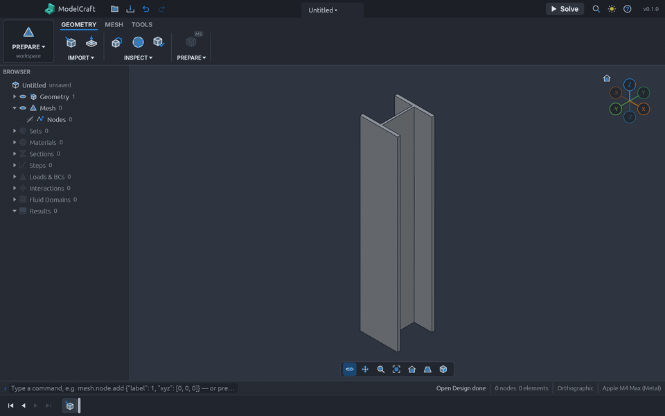
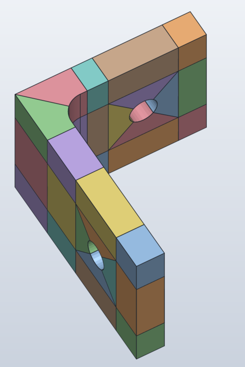
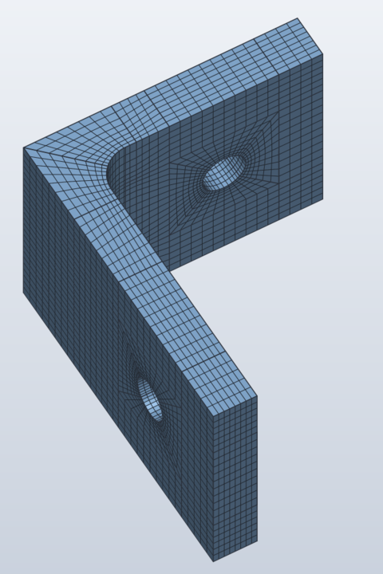
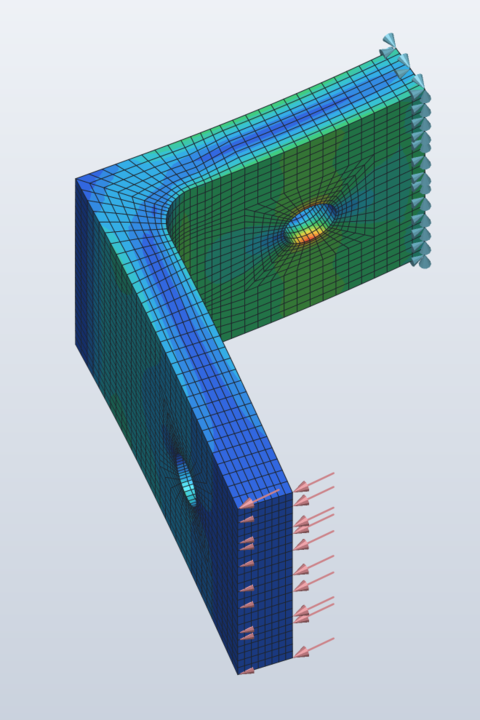
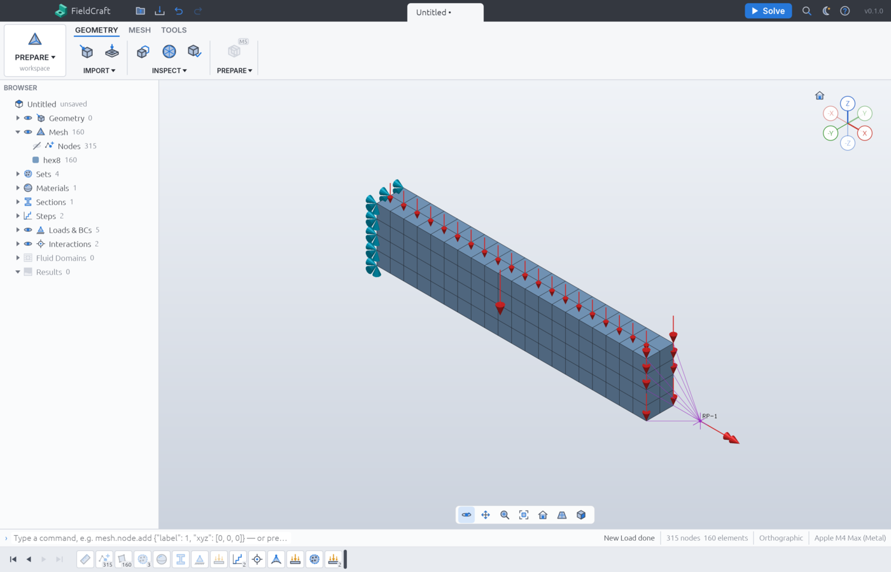

# FieldCraft

An open-source, clean-room CAE application in pure Rust: from a parametric SolidCraft part to a
verified finite element analysis, with tetrahedral and hexahedral meshing, its own implicit,
explicit, thermal and lattice Boltzmann solvers, and decks for Abaqus, Nastran and LS-DYNA. The
desktop app, the command line and AI agents (over MCP) drive the same commands.

**Status:** early but working end to end — open a part, mesh it, define the analysis, solve,
see the results — with a nonlinear implicit solver (large deformation, plasticity, rubber) now
in place. Hex meshing is the centre of gravity. Next: buckling and arc-length, contact, then
the wider material and multiphysics library. See [ROADMAP.md](ROADMAP.md).
**Want to help?** Pick an issue labelled
[good first issue](https://github.com/jyviko/fieldcraft/labels/good%20first%20issue) or
[help wanted](https://github.com/jyviko/fieldcraft/labels/help%20wanted) and read
[CONTRIBUTING.md](CONTRIBUTING.md).



An AI agent drives FieldCraft over [MCP](docs/mcp.md), each stage captioned with the tool it
calls: it opens an I-beam, hex meshes it, defines the material, the clamp and a 1000 N tip load,
solves, and shows the von Mises stress and the deformed shape (tip deflection 0.176 mm; beam
theory with shear 0.177 mm).
[MP4](docs/media/ibeam-analysis.mp4) · regenerated by [tools/demo-video](tools/demo-video/README.md).

## Hex meshing a part that does not sweep

A filleted L-bracket with a hole through each leg cannot be swept in one piece. Split into 30
cells in SolidCraft, FieldCraft meshes it all-hex as one conforming mesh — O-grids round the holes,
graded through the fillet — and its hex20 tip deflection matches a fine tet10 solution to 0.1 %.
The same part also meshes all-hex automatically with the octree mesher (`mesh.hex.octree`).

| Cells | Conforming hex mesh | Von Mises (clamp and load drawn) |
|---|---|---|
|  |  |  |

## What it does today

- **Geometry in:** SolidCraft designs (`.solidcraft`) with persistent face, edge and body names,
  and face-tagged 3MF meshes; surface checks (weld, manifold, orientation, self-intersection).
- **Meshing:** constrained Delaunay tetrahedra (tet4, tet10) with exact predicates and a
  certified validity gate; Delaunay refinement, smoothing and sliver removal; structured hex by
  sweeping, revolving and mapping (hex8, hex20), and conforming multi-block hex across a part
  split into cells (`mesh.hex.blocks`); unstructured octree all-hex for any part
  (`mesh.hex.octree`); 2D quad and tri meshes; quality metrics per element and set.
- **Elements:** solids (tet4, tet10, wedge6, hex8 with incompatible modes, hex20 full and
  reduced, hybrid u–p for near-incompressible materials), plane stress, plane strain and
  axisymmetric, trusses, Timoshenko beams, MITC3/MITC4 shells, springs, dashpots and point masses.
- **Model:** sets bound to geometry names, so they survive remeshing; isotropic and orthotropic
  elasticity, J2 plasticity (isotropic and kinematic hardening, Johnson–Cook), Johnson–Cook
  damage, neo-Hookean, Mooney–Rivlin and Yeoh hyperelasticity, thermal properties; fixed, displacement,
  symmetry and temperature conditions; forces, moments, pressure, gravity, centrifugal and heat
  loads; reference points with kinematic and distributing couplings; undo, redo and a
  text-diffable `.fieldcraft` file.
- **Solvers:** linear static and frequency (supernodal Cholesky, block Lanczos); nonlinear static
  by Newton–Raphson with automatic increments — large deformation (total Lagrangian) on every
  solid element, follower pressure, finite- and small-strain plasticity sharing one return map
  with the explicit solver, rubber and thermal strain, with measured quadratic convergence; steady and
  transient heat transfer and coupled thermal stress; explicit dynamics with plasticity, damage,
  erosion and rigid walls; D3Q19 lattice Boltzmann flow with forces on the part's faces. Results
  never depend on the thread count.
- **Decks:** Abaqus, Nastran and LS-DYNA writers, each refusing by name what it cannot express.
- **Results:** contours of stress, strain and displacement with a legend, deformed shapes, mode
  shapes, explicit and nonlinear frames, probes and reaction sums; supports, loads, reference
  points and couplings drawn in the viewport.
- **Verification:** every capability is checked against closed forms and published benchmarks
  (NAFEMS, MacNeal–Harder, Scordelis–Lo, the elastica, Hill's plastic cylinder, Rivlin's tube) in [`tests/oracle`](tests/oracle), with results frozen
  so they cannot drift: 170 of 176 quantities pass in 50 cases, the 6 others documented known
  failures ([docs/oracle.md](docs/oracle.md)).
- **Driving it:** a desktop app in the Craft family's layout, a CLI, a JSON control channel and an
  MCP server; every capability is a command ([docs/features.md](docs/features.md)).



## Build

```sh
cargo xtask ci                                  # fmt, assets, licences, layers, clippy, tests, wasm
cargo xtask test --heavy                        # the heavy (ignored) tests and the doc tests
cargo run -p fieldcraft-cli -- commands         # every command and its parameters
cargo run -p fieldcraft-cli -- run script.json  # run a command script
cargo run -p fieldcraft-cli -- mcp              # MCP server on stdio for AI agents (docs/mcp.md)
```

Rust 1.95 or later, with the `wasm32-unknown-unknown` target for `cargo xtask ci`.

## Documentation

- [Architecture](docs/architecture.md): crates, layers and the meshing pipeline
- [Element library](docs/elements.md) and [verification and validation](docs/verification.md)
- [Capability checklist](docs/parity.md) and [roadmap](ROADMAP.md)
- [Libraries and licences](docs/adr/0001-libraries.md)
- [AI agents (MCP)](docs/mcp.md): `claude mcp add fieldcraft -- /path/to/fieldcraft-cli mcp`
- [Control protocol](docs/control-protocol.md): driving the desktop app
- [Contributing](CONTRIBUTING.md) and [agent instructions](AGENTS.md)

## License

Dual-licensed under [MIT](LICENSE-MIT) or [Apache-2.0](LICENSE-APACHE), at your option. Notices
are in [NOTICE](NOTICE); third-party licences in [THIRD-PARTY-LICENSES.txt](THIRD-PARTY-LICENSES.txt).

FieldCraft is an independent project, not affiliated with, sponsored or endorsed by Dassault
Systèmes, MSC Software, Siemens or Ansys. Abaqus, Nastran, MSC Nastran, Simcenter Nastran and
LS-DYNA are trademarks of their owners and are named only to describe file compatibility.
