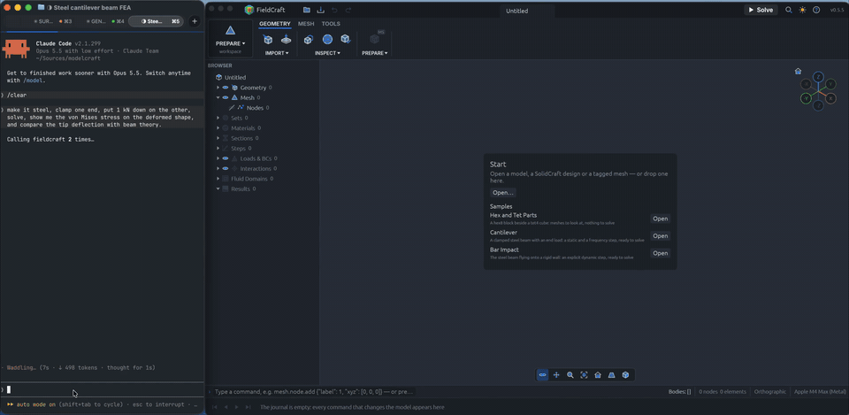

# FieldCraft

An open-source, clean-room CAE application in pure Rust: from a parametric SolidCraft part to a
verified finite element analysis, with tetrahedral and hexahedral meshing, its own implicit,
explicit, thermal and lattice Boltzmann solvers, and decks for Abaqus, Nastran and LS-DYNA. The
desktop app, the command line and AI agents (over MCP) drive the same commands.

**Status:** early but working end to end — open a part, mesh it, define the analysis, solve,
see the results — with a nonlinear implicit solver (large deformation, plasticity, rubber) now
in place. Hex meshing is the centre of gravity. Next: buckling and arc-length, contact, then
the wider material and multiphysics library. See [ROADMAP.md](ROADMAP.md).
**Want to help?** Pick an issue labelled
[good first issue](https://github.com/jyviko/fieldcraft/labels/good%20first%20issue) or
[help wanted](https://github.com/jyviko/fieldcraft/labels/help%20wanted) and read
[CONTRIBUTING.md](CONTRIBUTING.md).



*Claude driving FieldCraft through its [MCP server](docs/mcp.md): one prompt, and it opens the part, meshes it, defines and solves the analysis, then checks the tip deflection against beam theory. Real session, waits shortened. [Full video](docs/media/claude-mcp.mp4).*


An AI agent drives FieldCraft over [MCP](docs/mcp.md), each stage captioned with the tool it
calls: it opens an I-beam, hex meshes it, defines the material, the clamp and a 1000 N tip load,
solves, and shows the von Mises stress and the deformed shape (tip deflection 0.176 mm; beam
theory with shear 0.177 mm).
[MP4](docs/media/ibeam-analysis.mp4) · regenerated by [tools/demo-video](tools/demo-video/README.md).

## Download

[](https://github.com/jyviko/fieldcraft/releases/latest)
[](https://github.com/jyviko/fieldcraft/releases/latest)
[](https://github.com/jyviko/fieldcraft/releases/latest)
[](https://jyviko.github.io/fieldcraft/)

- **macOS:** open the `.dmg` and drag FieldCraft into Applications (Apple silicon and Intel).
- **Windows:** unzip and run `fieldcraft.exe`.
- **Linux:** the `.AppImage` (allow it to run as a program), or the `.tar.gz`.
- **Browser:** [try it at jyviko.github.io/fieldcraft](https://jyviko.github.io/fieldcraft/), no install.
- **Command line:** `fieldcraft-cli` ships in every package; AI agents connect to it over MCP
  ([docs/mcp.md](docs/mcp.md)).

Every release lists its checksums in `SHA256SUMS.txt`. Building from source is in
[CONTRIBUTING.md](CONTRIBUTING.md#get-it-running-about-10-minutes-on-a-fast-machine).

## Hex meshing a part that does not sweep

A filleted L-bracket with a hole through each leg cannot be swept in one piece. Split into 30
cells in SolidCraft, FieldCraft meshes it all-hex as one conforming mesh — O-grids round the holes,
graded through the fillet — and its hex20 tip deflection matches a fine tet10 solution to 0.1 %.
The same part also meshes all-hex automatically with the octree mesher (`mesh.hex.octree`).

| Cells | Conforming hex mesh | Von Mises (clamp and load drawn) |
|---|---|---|
|  |  |  |

## What it does today

- **Geometry in:** SolidCraft designs (`.solidcraft`) with persistent face, edge and body names,
  and face-tagged 3MF meshes; surface checks (weld, manifold, orientation, self-intersection).
- **Meshing:** constrained Delaunay tetrahedra (tet4, tet10) with exact predicates and a
  certified validity gate; Delaunay refinement, smoothing and sliver removal; structured hex by
  sweeping, revolving and mapping (hex8, hex20), and conforming multi-block hex across a part
  split into cells (`mesh.hex.blocks`); unstructured octree all-hex for any part
  (`mesh.hex.octree`); 2D quad and tri meshes; quality metrics per element and set.
- **Elements:** solids (tet4, tet10, wedge6, hex8 with incompatible modes, hex20 full and
  reduced, hybrid u–p for near-incompressible materials), plane stress, plane strain and
  axisymmetric, trusses, Timoshenko beams, MITC3/MITC4 shells, springs, dashpots and point masses.
- **Model:** sets bound to geometry names, so they survive remeshing; isotropic and orthotropic
  elasticity, J2 plasticity (isotropic and kinematic hardening, Johnson–Cook), Johnson–Cook
  damage, neo-Hookean, Mooney–Rivlin and Yeoh hyperelasticity, thermal properties; fixed, displacement,
  symmetry and temperature conditions; forces, moments, pressure, gravity, centrifugal and heat
  loads; reference points with kinematic and distributing couplings; undo, redo and a
  text-diffable `.fieldcraft` file.
- **Solvers:** linear static and frequency (supernodal Cholesky, block Lanczos); nonlinear static
  by Newton–Raphson with automatic increments — large deformation (total Lagrangian) on every
  solid element, follower pressure, finite- and small-strain plasticity sharing one return map
  with the explicit solver, rubber and thermal strain, with measured quadratic convergence; steady and
  transient heat transfer and coupled thermal stress; explicit dynamics with plasticity, damage,
  erosion and rigid walls; D3Q19 lattice Boltzmann flow with forces on the part's faces. Results
  never depend on the thread count.
- **Decks:** Abaqus, Nastran and LS-DYNA writers, each refusing by name what it cannot express.
- **Results:** contours of stress, strain and displacement with a legend, deformed shapes, mode
  shapes, explicit and nonlinear frames, probes and reaction sums; supports, loads, reference
  points and couplings drawn in the viewport.
- **Verification:** every capability is checked against closed forms and published benchmarks
  (NAFEMS, MacNeal–Harder, Scordelis–Lo, the elastica, Hill's plastic cylinder, Rivlin's tube) in [`tests/oracle`](tests/oracle), with results frozen
  so they cannot drift: 170 of 176 quantities pass in 50 cases, the 6 others documented known
  failures ([docs/oracle.md](docs/oracle.md)); against Abaqus's published benchmark results in [How FieldCraft compares with Abaqus](#how-fieldcraft-compares-with-abaqus).
- **Driving it:** a desktop app in the Craft family's layout, a CLI, a JSON control channel and an
  MCP server; every capability is a command ([docs/features.md](docs/features.md)).


## How FieldCraft compares with Abaqus

The Abaqus values are the ones Abaqus publishes in its Benchmarks Guide [^bg]. We never run Abaqus.
The FieldCraft values come from [docs/oracle.md](docs/oracle.md). Errors are measured against the benchmark's reference.
For each element we list Abaqus's best published mesh. The Guide doesn't give element counts for the NAFEMS meshes.

| Benchmark | Reference | Abaqus (element, result, error) | FieldCraft (element, result, error) |
|---|---|---|---|
| NAFEMS LE1 elliptic membrane, σ_yy at D | 92.7 MPa | CPS8 fine: 92.81, +0.12 %; CPS8R fine: 90.07, −2.8 % [^le1] | quad8 24 × 48: 92.648, −0.06 %; hex20 layer 24 × 48: 92.869, +0.18 % |
| NAFEMS LE10 thick plate, σ_yy at D | −5.38 MPa | C3D20R fine: −5.53, +2.8 %; C3D20 fine: −5.64, +4.8 %; C3D10HS fine: −5.51, +2.4 % [^le10] | hex20, 2 × (8 × 16 × 3): −5.334, −0.86 % |
| NAFEMS FV32 tapered membrane, f₁…f₆ | 44.623 … 391.44 Hz | CPS8R: worst mode 5, 381.32, +0.37 %; CPS6: worst +0.02 % [^fv32] | hex20 layer 16 × 8: every mode within 0.004 % |
| NAFEMS LE11 thermal cylinder, σ_zz at A | −105 MPa | C3D20 fine: −103.26, −1.7 %; C3D20R fine: −99.60, −5.1 % [^le11] | pending (thermal loads) |
| Scordelis–Lo roof, free-edge midpoint u_z | 0.3024 (MacNeal–Harder); Abaqus uses 91.2 mm | S4 18 × 18: 91.89 mm, +0.77 %; S8R 9 × 9: 91.90 mm, +0.8 % [^sl] | hex20R one layer, quarter 16 × 16: −0.3014, −0.33 % |
| Pinched cylinder, radial u under the load | 1.825 × 10⁻⁵ | S8R5, 2646 dof: 1.833 × 10⁻⁵, +0.44 %; S4R, 2646 dof: 1.779 × 10⁻⁵, −2.5 % [^pc] | pending (shells) |
| MacNeal–Harder twisted beam, thick, in-plane tip u | 5.424 × 10⁻³ | S4R 8 × 48: 5.430 × 10⁻³, +0.11 % [^tb] | pending (shells) |
| MacNeal–Harder pinched hemisphere | 0.0940 | not found (Abaqus publishes NAFEMS LE3, a different load and material) | pending (shells) |
| MacNeal–Harder patch, straight and curved cantilever, thick cylinder | see [docs/oracle.md](docs/oracle.md) | not found | hex8 incompatible: patch exact; straight cantilever −1.2 % to −10.8 %; curved −12 % / −20 %; thick cylinder −1.4 % |
| Cook's membrane, Euler and plate buckling | — | not found | see [docs/oracle.md](docs/oracle.md) |

Not like for like:
- **LE1 and FV32:** our hex20 rows model plane stress with a thin solid layer. Only the quad8 row matches Abaqus's CPS8 directly.
- **LE10:** our mesh is probably finer than Abaqus's "fine" mesh, but the Guide gives no element count, so this isn't certain. The Guide notes that only one element touches D in its fine mesh.
- **Scordelis–Lo:** Abaqus publishes shell elements only. Our row uses a single layer of solid elements. The two references differ slightly: 91.2 mm against MacNeal–Harder's normalised 0.3024.
- **Pinched cylinder:** Abaqus reports mesh size as degrees of freedom.

[^bg]: Abaqus 2017 Benchmarks Guide, hosted at <https://abaqus-docs.mit.edu/2017/English/SIMACAEBMKRefMap/>. Each footnote names the page, and the values are in its "Results and discussion".
[^le1]: "LE1: Plane stress elements—elliptic membrane", Table 1, Abaqus/Standard: [simabmk-c-le1.htm](https://abaqus-docs.mit.edu/2017/English/SIMACAEBMKRefMap/simabmk-c-le1.htm)
[^le10]: "LE10: Thick plate under pressure", Table 1, Abaqus/Standard: [simabmk-c-le10.htm](https://abaqus-docs.mit.edu/2017/English/SIMACAEBMKRefMap/simabmk-c-le10.htm)
[^fv32]: "FV32: Cantilevered tapered membrane", frequency table: [simabmk-c-fv32.htm](https://abaqus-docs.mit.edu/2017/English/SIMACAEBMKRefMap/simabmk-c-fv32.htm)
[^le11]: "LE11: Solid cylinder/taper/sphere—temperature loading": [simabmk-c-le11.htm](https://abaqus-docs.mit.edu/2017/English/SIMACAEBMKRefMap/simabmk-c-le11.htm)
[^sl]: "Barrel vault roof problem", Table 1, regular meshes: [simabmk-c-barrelvault.htm](https://abaqus-docs.mit.edu/2017/English/SIMACAEBMKRefMap/simabmk-c-barrelvault.htm)
[^pc]: "Pinched cylinder", regular-mesh table: [simabmk-c-pinchcyl.htm](https://abaqus-docs.mit.edu/2017/English/SIMACAEBMKRefMap/simabmk-c-pinchcyl.htm)
[^tb]: "Twisted beam" results table: [simabmk-c-twistedbeam.htm](https://abaqus-docs.mit.edu/2017/English/SIMACAEBMKRefMap/simabmk-c-twistedbeam.htm)

## Build

```sh
cargo xtask ci                                  # fmt, assets, licences, layers, clippy, tests, wasm
cargo xtask test --heavy                        # the heavy (ignored) tests and the doc tests
cargo run -p fieldcraft-cli -- commands         # every command and its parameters
cargo run -p fieldcraft-cli -- run script.json  # run a command script
cargo run -p fieldcraft-cli -- mcp              # MCP server on stdio for AI agents (docs/mcp.md)
```

Rust 1.95 or later, with the `wasm32-unknown-unknown` target for `cargo xtask ci`.

## Documentation

- [Architecture](docs/architecture.md): crates, layers and the meshing pipeline
- [Element library](docs/elements.md) and [verification and validation](docs/verification.md)
- [Capability checklist](docs/parity.md) and [roadmap](ROADMAP.md)
- [Libraries and licences](docs/adr/0001-libraries.md)
- [AI agents (MCP)](docs/mcp.md): `claude mcp add fieldcraft -- /path/to/fieldcraft-cli mcp`
- [Control protocol](docs/control-protocol.md): driving the desktop app
- [Releasing](docs/releasing.md): how a release is built, verified and published
- [Contributing](CONTRIBUTING.md) and [agent instructions](AGENTS.md)

## License

Dual-licensed under [MIT](LICENSE-MIT) or [Apache-2.0](LICENSE-APACHE), at your option. Notices
are in [NOTICE](NOTICE); third-party licences in [THIRD-PARTY-LICENSES.txt](THIRD-PARTY-LICENSES.txt).

FieldCraft is an independent project, not affiliated with, sponsored or endorsed by Dassault
Systèmes, MSC Software, Siemens or Ansys. Abaqus, Nastran, MSC Nastran, Simcenter Nastran and
LS-DYNA are trademarks of their owners and are named only to describe file compatibility.
