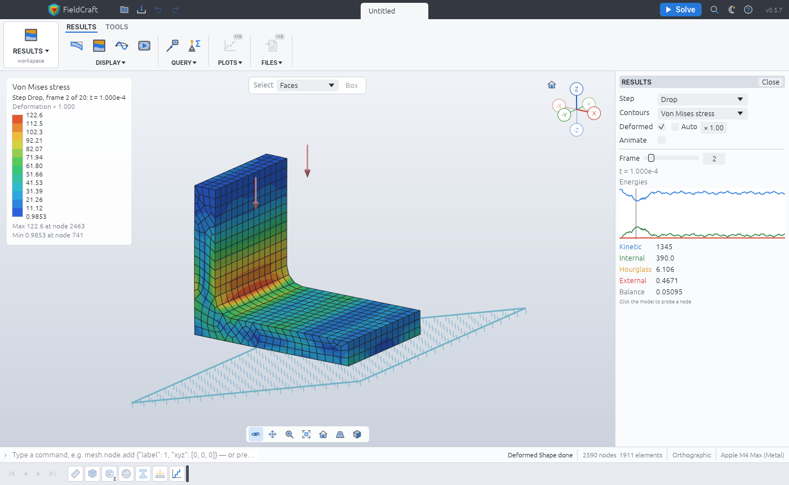

# Examples

Every example is a built-in sample: open it from **File ▸ Samples** (or the start screen), with
`fieldcraft --sample NAME`, or with the `file.sample` command (`{"name": "drop-test"}`), then
press **Solve** (`solve.run`). Each opens fully defined — geometry, mesh, materials, boundary
conditions, loads and steps — in mm, t, s, N and MPa, and opens and solves within half a minute. The geometry is our
own: SolidCraft scripts run when the sample opens (a recipe from [`tests/corpus`](../tests/corpus)
or one written in `crates/engine/src/sample.rs`). Each sample has a test in
`crates/engine/src/sample.rs` that opens it, checks it clean, solves it and holds its result to
the check given below.

## Drop test (`drop-test`)

An aluminium L-bracket (60 × 40 mm foot, 50 mm upright, 8 mm thick, R6 fillet) falls 2 m onto a
rigid floor tilted 15°, so the end of its foot strikes first. Explicit dynamics for 1 ms with
gravity: 1 911 swept hex8 elements (one-point, stiffness hourglass control), bilinear plasticity
(yield 240 MPa), the floor a rigid wall. About 8 400 increments, a few seconds.

**Look at:** the frames from the strike (Results ▸ Frame): the compression wave leaves the
struck corner and the upright's inertia bends the fillet, where von Mises peaks near 120 MPa —
below yield, so the drop leaves no permanent set. The energies plot shows the kinetic energy
turning into vibration with a balance under 0.01 %.

**Check:** the mass equals ρ V of the bracket (0.5 %); it meets the floor at √(2 g h) =
6.26 m/s, with ½ m v² = 1 748 mJ of kinetic energy (1 %); energy is conserved (balance < 1 %);
by 1 ms the floor has taken about half its downward momentum.
