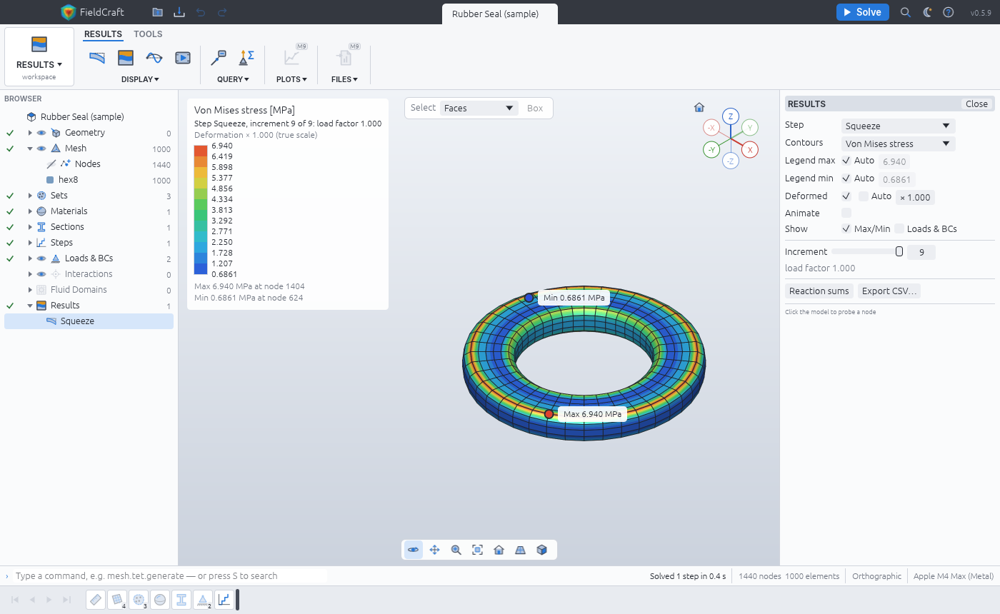
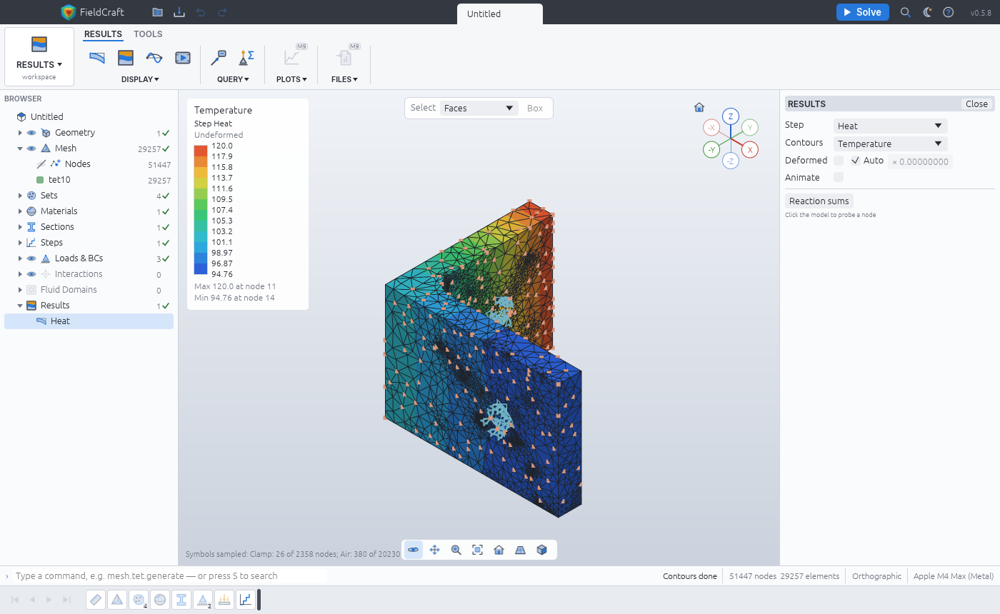
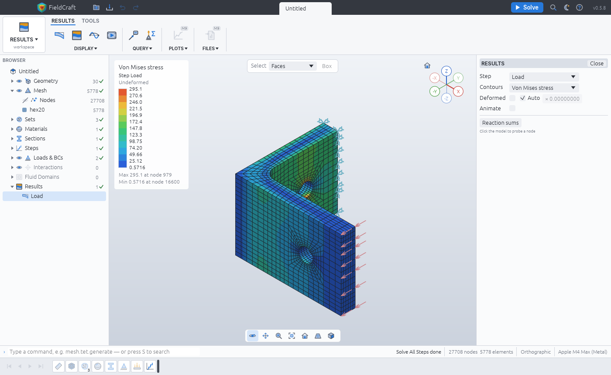
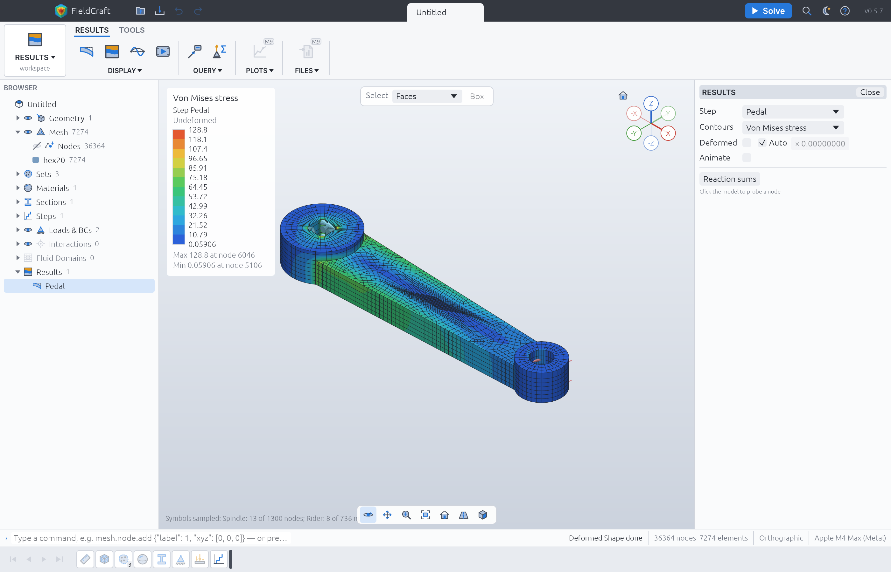

# Examples

Every example is a built-in sample: open it from **File ▸ Samples** (or the start screen), with
`fieldcraft --sample NAME`, or with the `file.sample` command (`{"name": "drop-test"}`), then
press **Solve** (`solve.run`). Each opens fully defined — geometry, mesh, materials, boundary
conditions, loads and steps — in mm, t, s, N and MPa, and opens and solves within half a minute. The geometry is our
own: SolidCraft scripts run when the sample opens (a recipe from [`tests/corpus`](../tests/corpus)
or one written in `crates/engine/src/sample.rs`). Each sample has a test in
`crates/engine/src/sample.rs` that opens it, checks it clean, solves it and holds its result to
the check given below.

## Drop test (`drop-test`)

An aluminium L-bracket (60 × 40 mm foot, 50 mm upright, 8 mm thick, R6 fillet) falls 2 m onto a
rigid floor tilted 15°, so the end of its foot strikes first. Explicit dynamics for 1 ms with
gravity: 1 911 swept hex8 elements (one-point, stiffness hourglass control), bilinear plasticity
(yield 240 MPa), the floor a rigid wall. About 8 400 increments, a few seconds.

**Look at:** the frames from the strike (Results ▸ Frame): the compression wave leaves the
struck corner and the upright's inertia bends the fillet, where von Mises peaks near 120 MPa —
below yield, so the drop leaves no permanent set. The energies plot shows the kinetic energy
turning into vibration with a balance under 0.01 %.

**Check:** the mass equals ρ V of the bracket (0.5 %); it meets the floor at √(2 g h) =
6.26 m/s, with ½ m v² = 1 748 mJ of kinetic energy (1 %); energy is conserved (balance < 1 %);
by 1 ms the floor has taken about half its downward momentum.

## Rubber seal (`rubber-seal`)

A rubber gasket ring (20 mm inside radius, 30 mm outside, 10 mm high) squeezed 2.5 mm (25 %)
between two plates bonded to it. Generic rubber, E = 6 MPa, ν = 0.49, Mooney–Rivlin with
C01 = 0.2 MPa; 1 000 hybrid (u–p) hex8 elements in four mapped quarter blocks. Nonlinear static
with large deformation: Newton–Raphson in nine increments, under a second.

**Look at:** the deformed shape at scale 1 — the free inner and outer walls bulge out, and
von Mises peaks (about 7 MPa) where the bulge meets the bonded plates. Results ▸ Increment steps
through the converged increments.

**Check:** the same ring between frictionless plates compresses evenly, and its force matches
the closed form for an incompressible Mooney–Rivlin solid in uniaxial compression,
P = 2 (λ − λ⁻²)(C10 + C01/λ) per original area: 3 430 N against 3 466 N (within 3 %). Bonded,
the bulge makes it stiffer (shape factor 0.5): 6 518 N, held between 1.05 and 2.5 times the
frictionless force. The groove and the plates are prescribed displacements today; with implicit
contact (#161) the ring will be pressed by contact against a groove.

## Flow past a bracket (`flow-past`)

Air (ρ = 1.2 kg/m³, μ = 1.8 × 10⁻⁵ Pa s) at 25 mm/s past the same L-bracket standing on the
floor, the upright's back to the wind. A 240 × 120 × 100 mm box of 2.5 mm cells (184 320),
uniform inlet, outlet at zero pressure, a no-slip floor and slip walls at the sides and top;
D3Q19 lattice Boltzmann (TRT) for 16 s, about 6.7 flow-throughs, ten frames. Reynolds number
83 on the upright's 50 mm height: laminar, a steady wake. About 10 s.

**Look at:** the step's report (`solve.fluid`, or Results after Solve): the force on every
named face of the bracket and on each side of the box, final and time-averaged, and the mass
history; `solve.probe` with `points` gives the velocity and pressure in any cell, and with
`forces` each face's force history.

**Check:** the drag on the bracket, as a coefficient on the upright's frontal area
(40 × 50 mm), is 2.3 — a bluff plate standing on a wall at low Reynolds number in a box it
blocks by 17 %, held between 1 and 3.5 (a flat plate broadside to the flow is about 1.2 at high
Reynolds number and rises as it falls); the lattice's mass changes by less than 1 %.

There is no picture yet: the viewport does not draw flow results (velocity slices and
streamlines are planned in M12), so this example is numbers only for now.

## Heated bracket (`heated-bracket`)

The corpus filleted bracket (`tests/corpus/filleted-bracket`: an 8 mm L-bracket, R6 fillet, a
hole through each leg) in steel, both hole bores clamped. The end of the upright is held at
120 °C by a heater; the rest of its outside loses heat to still air at 20 °C
(h = 10 W/(m² K)); steel conducts with k = 50 W/(m K), expands with α = 12 × 10⁻⁶/K and is
stress free at 20 °C. One coupled temperature–displacement step (steady) on 23 641 tet10
elements: about 8 s to open (meshing) and 13 s to solve.

**Look at:** Contours ▸ Temperature: the upright stays within a few degrees of the heater and
the foot falls to 95 °C, a steady balance between conduction and the air. Contours ▸ Von Mises
shows the stress of the growth the clamps hold back: tens of MPa through the legs, peaking at the
edges of the clamped bores, where a rigid clamp is a stress singularity (about 1 GPa there, a
figure that grows as the mesh is refined: read the stress a little away from the bore).

**Check:** the temperatures lie between the air's and the heater's and fall away from the heater.
For the expansion, the test puts the air at the heater's temperature, so the bracket warms
evenly by ΔT = 100 K, and clamps the foot's hole alone: the bracket then grows freely about it,
and a point moves α ΔT times its distance from the hole's axis. The upright's top moves −0.0432
mm along x (within 2 %); the foot's end, 16 mm from the clamped bore, which cannot grow, moves
0.0228 mm against 0.024 mm (within 6 %).

## Hex-meshed bracket (`bracket-hex`)

The same filleted bracket split into 30 cells in SolidCraft
(`tests/corpus/filleted-bracket-blocks`: planar cuts through the legs and diagonal cuts round
the holes and the fillet, each cell a six-sided block), meshed by `mesh.hex.blocks` as one
conforming all-hex mesh: 5 778 hex20 elements of 3 mm, O-grids round the holes, graded through
the fillet, every shared face meshed once. Steel; the upright's end clamped, 1 kN down on the
foot's end. Linear static: about 2 s to open (the cells are rebuilt from the script) and 3 s to
solve.

**Look at:** the mesh (Prepare ▸ Mesh) — mapped blocks meeting face to face with no pyramids or
tets — and the von Mises contours on the deformed shape: the stress runs round the fillet and
peaks at 295 MPa at the upright's hole.

**Check:** the tip of the foot moves 0.509 mm down, within 1 % of a 48 016-element tet10
solution of the unpartitioned part (0.5093 mm, `crates/testkit/tests/bracket_blocks.rs`), and the
clamp carries the whole 1 kN.

## Bicycle crank arm (`crank-arm`)

A 170 mm aluminium crank built in SolidCraft (`crates/engine/samples/crank-arm.json`): a 16 mm
arm tapering from 38 to 24 mm, root arcs into a Ø46 × 22 spindle boss with a 12.7 mm square bore
(R1.5 corners) and a Ø30 × 20 pedal boss with a Ø14 hole, and an 82 × 14 × 8 pocket in its back
(R5 corners). It is a stack of extrusions along z, so `mesh.hex.generate` sweeps it all-hex:
7 274 hex20 elements of 3 mm, all valid, scaled Jacobian min 0.17, mean 0.83. To keep it
sweepable the hex variant leaves out the pocket's floor fillet and the bosses' 1.5 mm chamfers,
and its root arcs meet the bosses about 20° off tangent (a tangent meeting leaves a zero-angle
cusp on the arm's top face, where any hex is degenerate). 6061-T6 (E = 68 900 MPa, ν = 0.33); the
square bore's faces fixed, 1500 N on the pedal hole in the crank's plane, across the arm (−y).
Linear static: about 4 s to open and 7 s to solve.

**Look at:** the swept mesh (Prepare ▸ Mesh), eight layers through the arm, and the von Mises
contours: the bending stress grows along the arm toward the root; the peak, 129 MPa, sits at a
square-bore corner where the rigid clamp meets the free face, a support singularity.

**Check:** σxx on the arm's sides at x = 29 mm is ±62.4 MPa against the beam formula
M/Z = 1500 · 141 / (16 · 35.6² / 6) = 62.6 MPa (0.3 %); a 41 815-element tet10 solution of the
full part gives 62.3 MPa. The pedal bore moves 0.75 mm down (tet10: 0.70–0.75 mm; Euler–Bernoulli
with a rigid clamp: 0.58 mm, without shear or the boss's compliance), and the spindle carries the
whole 1500 N and 255 N·m.
